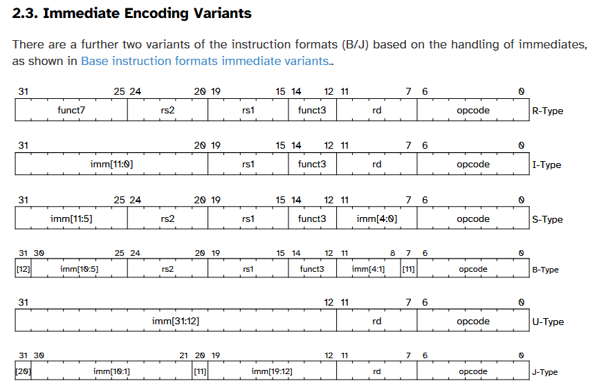
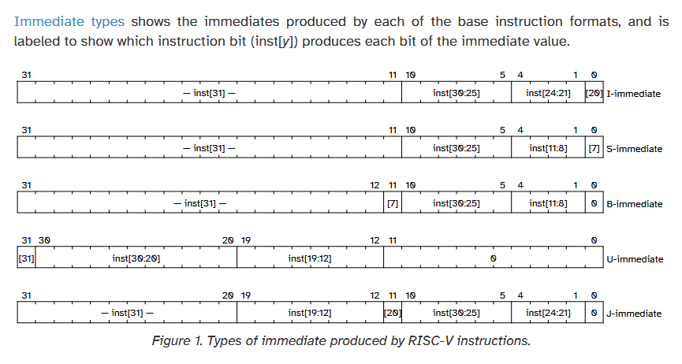
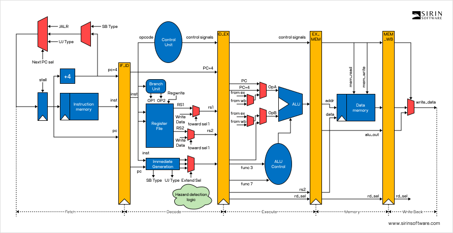
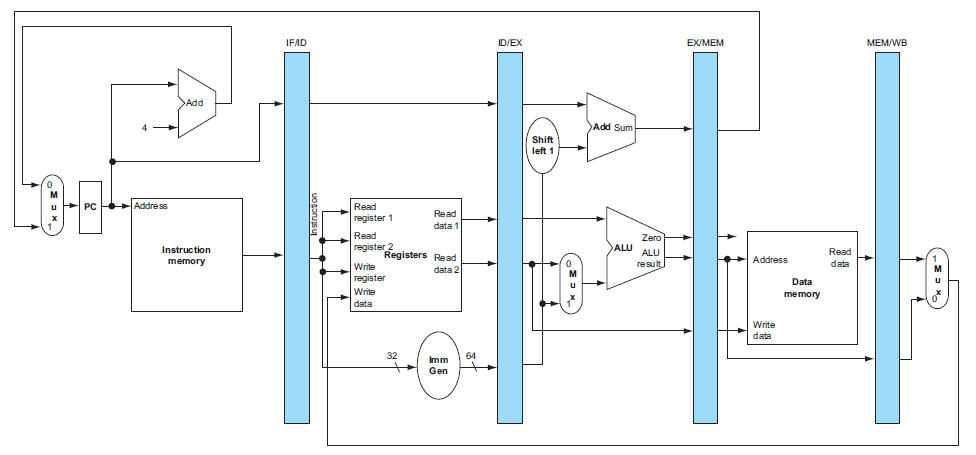

# RV32E pipelined processor in Verilog

A 5-stage pipelined RISC-V processor implementing RV32E (the embedded base
integer instruction set: the RV32I instructions with 16 registers, `x0`-`x15`),
with self-checking test programs and a cycle-by-cycle pipeline trace.

[Original repository](https://github.com/joaovitorshenriques/Risc-V)

## Getting started

Every tool (Icarus Verilog, Verilator, GTKWave, GNU binutils for RISC-V, Lua 5.4) comes
from the Nix flake. The RISC-V binutils are not in the Nix binary cache, so the
first `nix develop` builds them from source (a few minutes, once):

```sh
nix develop
make test                       # unit tests + programs (Icarus Verilog)
make test SIM=verilator         # same tests on Verilator
make prog T=evaluation          # a single program
make trace T=evaluation         # pipeline state cycle by cycle
make wave T=evaluation          # VCD waveform for GTKWave
make lint                       # Verilator --lint-only (undriven wires, widths, ...)
make paper                      # build the paper: latex/main.tex -> build/paper/main.pdf
```

## Tests

There are two kinds of tests, both run by [scripts/test.lua](scripts/test.lua):

- **Unit tests:** every `tb/**/tb_<name>.v` is discovered automatically and
  compiled against all of `src/`, with the testbench as the top module. A
  testbench passes when it prints at least one `[PASS]` and no `[FAIL]`.
- **Programs:** each file in [tests/programs/](tests/programs/) is an assembly
  program with its expected results in comments:

  ```asm
  # expect: x9=6 x1=-1 mem[0x8]=4    values at the end of the run
  # init:   mem[4]=7                 initial data memory (optional)
  # cycles: 200                      cycle limit (optional, default 1000)
  ```

  The program is assembled with GNU `as` (`-march=rv32e`) and linked at address 0
  by [scripts/assemble.lua](scripts/assemble.lua),
  run through [tb/core/tb_cpu.v](tb/core/tb_cpu.v) until its last instruction
  leaves WB, and the listed registers/memory words are compared.

`make trace` shows which instruction is in each stage and what happened
(forwarding, stall, flush, register and memory writes):

```
cycle | IF                | ID                | EX                | MEM               | WB                | events
    4 | add x1, x1, x2    | add x2, x1, x0    | lw x1, 4(x0)      | sw x2, 4(x0)      | li x2, 7          | STALL x2<-0x00000007 mem[0x00000004]<-0x00000007
    5 | add x1, x1, x2    | add x2, x1, x0    | (bubble)          | lw x1, 4(x0)      | sw x2, 4(x0)      |
    6 | add x1, x1, x2    | add x1, x1, x2    | add x2, x1, x0    | (bubble)          | lw x1, 4(x0)      | fwdA<-WB x1<-0x00000007
```

To assemble a program on its own (prints the disassembly and writes `out.hex`):

```sh
lua scripts/assemble.lua program.s out
```

Programs are plain GNU assembler: comments start with `#` (`;` separates
statements), and pseudo-instructions such as `li`, `mv`, `j` and `ret` work.

## Microarchitecture

Classic 5-stage pipeline (IF, ID, EX, MEM, WB) in [src/core/cpu.v](src/core/cpu.v):

- **16 registers** (`REG_COUNT = 16`). Instructions naming `x16`-`x31` are
  reserved in RV32E: GNU `as -march=rv32e` rejects them, and if one reaches the
  processor anyway it becomes a bubble (no effect) and raises `illegal_reg`,
  which the test runner reports as a failure. There are no traps yet.

- **Forwarding** from EX/MEM and MEM/WB into the EX operands; the register file
  returns the value being written in the same cycle (WB -> ID).
- **Load-use hazard:** 1 stall cycle (PC and IF/ID hold, bubble into ID/EX).
- **Branches and jumps are resolved in EX**, using the forwarded operands; when
  taken, the two younger instructions are flushed (2-cycle penalty).
- `jal`/`jalr` write PC+4 to `rd`; `auipc` uses the PC as ALU operand A.
- Branch/jump offsets are in bytes, as in the RISC-V spec.

### Instruction support

| Status | Instructions |
|---|---|
| Implemented and tested | `lui` `auipc` `jal` `jalr`, `beq` `bne` `blt` `bge` `bltu` `bgeu`, `lw` `sw`, `addi` `slti` `sltiu` `xori` `ori` `andi` `slli` `srli` `srai`, `add` `sub` `sll` `slt` `sltu` `xor` `srl` `sra` `or` `and` |
| Missing | `lb` `lh` `lbu` `lhu` `sb` `sh` (they currently behave like `lw`/`sw`), `fence`, `ecall`, `ebreak` |

Full list: [docs/rv32e_base_instructions.md](docs/rv32e_base_instructions.md).

## Project layout

```
src/
  core/cpu.v              processor (top: rv32e_cpu)
  core/*.vh               constants and ALU operation codes
  stages/                 pipeline registers IF/ID, ID/EX, EX/MEM, MEM/WB
  components/             ALU, register file, immediate extractor, branch decision, ...
  control/                control unit, ALU control, forwarding, hazard detection
  memory/                 instruction and data memories
tb/                       unit testbenches, plus tb/core/tb_cpu.v for programs
tests/programs/           test programs with expected results
scripts/                  test.lua (test runner), sim.lua (Icarus/Verilator), assemble.lua (GNU as)
docs/                     ISA spec, diagrams and the course report (in Portuguese)
```

## RISC-V references

- [RISC-V Technical Specifications](https://lf-riscv.atlassian.net/wiki/spaces/HOME/pages/16154769/RISC-V+Technical+Specifications)
- [RV32I Base Integer Instruction Set, version 2.1 (PDF)](https://drive.google.com/file/d/1uviu1nH-tScFfgrovvFCrj7Omv8tFtkp/view?pli=1),
  local copy: [docs/riscv-unprivileged.pdf](docs/riscv-unprivileged.pdf).
  Most relevant chapters: 2.3 Immediate Encoding Variants, 2.4 Integer Computational Instructions.

### Registers and ABI names (RV32E, ILP32E ABI)

| Register  | ABI name | Usage                          |
|-----------|----------|--------------------------------|
| x0        | zero     | Constant zero                  |
| x1        | ra       | Return address                 |
| x2        | sp       | Stack pointer                  |
| x3        | gp       | Global pointer                 |
| x4        | tp       | Thread pointer                 |
| x5 - x7   | t0 - t2  | Temporaries                    |
| x8        | s0 / fp  | Saved register / frame pointer |
| x9        | s1       | Saved register                 |
| x10 - x11 | a0 - a1  | Arguments / return values      |
| x12 - x15 | a2 - a5  | Arguments                      |

RV32I also has `x16`-`x31` (`a6`-`a7`, `s2`-`s11`, `t3`-`t6`); RV32E does not.





